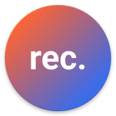
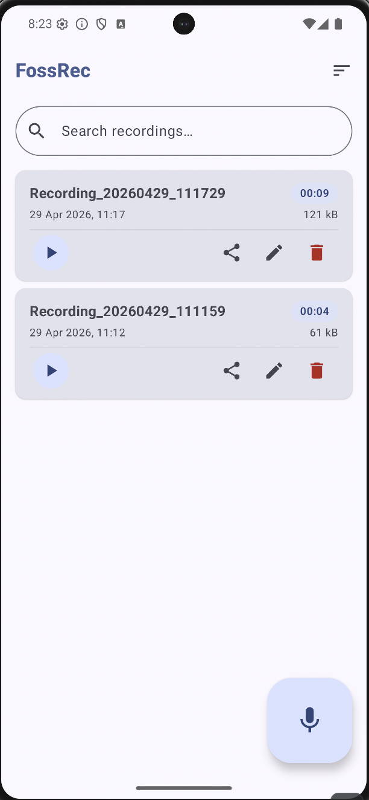

  

<h1 align="center">FossRec</h1>

A minimal, private Android audio recorder. No internet. No accounts. No bullshit.

  
   

---

## ⚠️ Legal notice — read this first

**Recording people without their consent is illegal in many countries.**
Laws on recording conversations vary from one place to another, and it is *your* responsibility to know and respect the rules that apply to you.

FossRec is only a tool. You alone are responsible for how you use it. The developer accepts **no liability** for any misuse of the app or for any legal consequence of recordings made with it.

For this reason, the app shows this notice on first launch. You must tick *"I have read and understood"* to continue — otherwise the app closes.

## Why

Every audio recorder app I tried had at least one of these problems: unnecessary permissions, silent uploads to unknown servers, mandatory accounts, or hidden telemetry. So I built my own.

## Features

- Record audio from the microphone, saved as **M4A** (AAC, 192 kbps, 44.1 kHz)
- Files saved **locally** on device — nothing leaves your phone
- No internet permission, no account, no cloud, no tracking
- Pause / resume, rename, share, search and sort
- **Automatic split** of long recordings (by file size and/or duration)
- Optional **fingerprint lock**
- **Dark / light / automatic** theme
- Two **home-screen widgets** (mini, and large with pause)
- English and French, selectable in the app
- **No metadata** kept in the audio files

All options live in **Settings** (gear icon, top right).

### Automatic split

Some speech-to-text tools reject files above 100 MB, or work better on shorter ones. In **Settings → Recording** you can have FossRec cut a recording into several files, without ever stopping it:

| Option | Presets |
|---|---|
| Split by **file size** | 25 · 50 · **100** · 200 · 500 MB |
| Split by **duration** | 5 · 10 · **15** · 30 · 60 min |

- Both are off by default and can be combined: the first limit reached wins.
- When a limit is reached, the current part is saved and the next one starts right away. There may be a very short gap (a fraction of a second) at the cut.
- Parts are named `Recording_<date>_part01.m4a`, `_part02`, … and are shown **linked together** in the list: one header with the number of parts, total duration and size, and the parts attached below it by a vertical line. The trash icon on the header deletes all the parts at once.
- A recording that never reached a limit keeps a plain name, without `_part01`.
- At the default bitrate, 100 MB is about 69 minutes of audio.

### Fingerprint lock (optional)

Off by default. Turn it on in **Settings → Security & privacy**: FossRec then asks for your fingerprint, face unlock or screen lock each time you open it, and locks again every time you leave it. Turning it **off** also asks for your fingerprint, so nobody else can remove it. The option is only available if your phone has a fingerprint, face unlock or screen lock set up.

The lock protects the app, not the files themselves (see below).

### Theme and language

In **Settings → Appearance** you can pick **Auto**, **Light** or **Dark**. Auto follows your phone's dark mode automatically (and, on Android 12 and later, your wallpaper colors — Material You). You can also choose the app language: English, French, or your phone's language.

### List refresh and swipe to delete

- When you stop a recording, the list **refreshes by itself** and the new recording appears at the top (with the default "newest first" sort). When a recording is split, each new part shows up in the list as soon as it starts.
- **Swipe a recording left or right to delete it.** A confirmation is always asked first, so nothing is lost by accident.

### Widgets

Add them from your launcher's widget picker:

- **FossRec · Mini** (1×1): one button to start / stop, with a small timer while recording.
- **FossRec · Large** (4×2): big timer, status, **pause / resume** and start / stop.

The first time, or if the microphone permission is missing, the record button opens the app instead so you can grant it. Starting a recording from a widget does not unlock the app: if the lock is enabled you still need it to see or play recordings.

## Privacy & security

### What is stored, and where

- **Recordings** are stored in the app's private folder: `Android/data/ch.nthnbch.fossrec/files/`. Other apps cannot read it, and the app has no storage permission. It is removed when you uninstall FossRec — **share or copy a recording before uninstalling** if you want to keep it.
- **Settings** (split, theme, language, lock) are stored in the app's private preferences. Nothing else is stored: no history, no analytics, no logs.
- **Nothing leaves the phone.** There is no internet permission, and Android backups are disabled, so nothing is copied to the cloud either.
- **Files are not encrypted.** The fingerprint lock only protects the app screen. Someone who can unlock your phone and connect it to a computer can still reach the files.

### No metadata in the audio files

FossRec never requests location access and never writes GPS data. Android's recorder does embed a creation date and the Android version inside M4A files; FossRec **erases both** as soon as a recording is saved (the audio itself is not touched). What remains is the file name, which contains the recording date and time (`Recording_YYYYMMDD_HHMMSS`), and the file's modification date on your phone. Rename a file before sharing it if that matters to you.

### Permissions

| Permission | Why | If refused |
|---|---|---|
| **Microphone** | Required to record audio | You cannot record |
| **Notifications** | Show the recording in the notification bar, with Pause / Stop buttons | Recording works exactly the same, controlled from the app and the widgets |
| Foreground service (microphone) | Keep recording when the screen is off (granted automatically, no prompt) | — |
| Biometric | Only for the optional lock (granted automatically, no prompt) | — |

No storage, location, contacts or internet permission is requested.

## Built With

- Kotlin
- Jetpack Compose (Material 3)
- Android native (no third-party SDKs)
- Gradle Kotlin DSL

Sizes and spacing follow the golden ratio (Fibonacci scale: 5 · 8 · 13 · 21 · 34 · 55 · 89 dp).

Tested on Pixel 7 Pro only.
